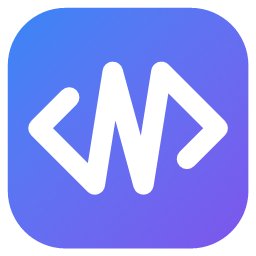

<p align="center">
  
</p>

<h1 align="center">next_code</h1>

<p align="center">
  Native, AI-first IDE written in Rust on <a href="https://crates.io/crates/gpui">gpui</a>.
</p>

<p align="center">
  <a href="https://github.com/AmedeoBiolatti/nextcode/actions/workflows/ci.yml"></a>
  <a href="https://github.com/AmedeoBiolatti/nextcode/releases/latest"></a>
</p>

## Features

- **Editor**: multiple cursors, split panes with session restore, Vim mode,
  themes, spell checking in comments and strings, tree-sitter highlighting
  for 16 languages, Markdown preview.
- **Settings**: a Settings page for every option, the theme included, kept
  in sync with `settings.json`.
- **Language servers**: completion, go to definition, find references, call
  hierarchy, parameter and inlay hints, rename, quick fixes, formatting.
- **Git**: PyCharm-style Commit window, commit graph, side-by-side diffs,
  branches, worktrees, stash and shelf, blame, hunk staging.
- **Remote projects**: WSL distros, dev containers and machines over SSH
  (Tailscale machines listed for you), with search,
  language servers, terminals and debugging running where the project
  lives, port forwarding, and your git credentials inside.
- **Python**: uv projects and environments, pytest, Jupyter and marimo
  notebooks.
- **Run and debug**: run configurations, a test runner, debugging over DAP
  (debugpy, CodeLLDB, lldb-dap).
- **Workflows**: one YAML file that starts a multi-project development
  environment.
- **Extensions**: sandboxed WebAssembly extensions written in Rust, with
  native panels, controls and charts; built-in features (notebooks,
  workflows, Python, sticky notes, Remote - SSH) can be turned on and off.
- **Built for agents**: a stable path for every part of the UI (Pinpoint),
  sticky notes between people and agents, a headless JSON mode.

## Install

Prebuilt x86_64 builds for Linux and Windows are attached to each
[release](https://github.com/AmedeoBiolatti/nextcode/releases).

**Linux**

```sh
curl -fsSL https://raw.githubusercontent.com/AmedeoBiolatti/nextcode/main/scripts/install-release.sh | sh
```

Installs into `~/.local/share/next_code/bin`, links `next_code` into
`~/.local/bin` and adds next_code to the applications menu. Needs the usual
desktop libraries (Wayland or X11, xkbcommon, fontconfig, Vulkan).

**Windows** (PowerShell)

```powershell
irm https://raw.githubusercontent.com/AmedeoBiolatti/nextcode/main/scripts/install-release.ps1 | iex
```

Installs into `%LOCALAPPDATA%\next_code\bin`, adds that folder to your
`PATH` and adds next_code to the Start menu.

Run the command again, or use **Help > Check for Updates…** in the editor,
to update. Both scripts check the download against the release's
`SHA256SUMS`. For a specific release, pipe into
`NEXT_CODE_VERSION=v0.1.0 sh` instead of `sh`, or run
`$env:NEXT_CODE_VERSION = "v0.1.0"` in PowerShell first.

## Usage

```sh
next_code path/to/project   # open a folder
next_code                   # reopen the windows from last time
next_code --quit            # stop the running editor
```

`next_code` hands its command line to the editor that is already running,
so a second launch opens a window in that process instead of starting a
new one.

## Build from source

Needs stable Rust, plus the MSVC Build Tools on Windows. On Ubuntu, install
the system libraries first:

```sh
sudo apt-get install -y build-essential pkg-config cmake clang libclang-dev libfontconfig-dev libfreetype-dev libxkbcommon-dev libxkbcommon-x11-dev libwayland-dev libx11-dev libxcb1-dev libssl-dev libvulkan-dev libzstd-dev
```

Then:

```sh
cargo build --release --workspace --locked
./target/release/next_code .
```

`scripts/install-linux.sh` (or `scripts\install.ps1` on Windows) installs a
local build like a release. CI builds and tests on Linux and Windows.
[Build and run](docs/building.md) covers the launcher, the grammar
libraries and the `dist` profile; [Repository layout](docs/architecture.md)
describes the crates.

## Documentation

The [docs](docs/README.md) cover each part of the editor: editing and code
navigation, git, remote projects, Python and notebooks, run and debug,
workflows, and the tools for agents.

## Roadmap

- **M0** editor core: window, file tree, tabs, editing, save, syntax highlighting, fuzzy file finder — *done*
- **M1** LSP (completion, go-to-definition, diagnostics), resizable docks, terminal, project search, Problems panel, external file watching — *done*
- **M2** host agent protocol, WSL projects — *done*
- **M3** git panel and diff view, multiple workspaces — *done*
- **M4** git review: commit graph, compare with branches/commits, compact change trees, side-by-side and whole-file diffs — *done*
- **M5** git operations: branches, worktrees, fetch/pull/push, amend, hunk staging — *done*
- **M6** uv projects (Python panel, environments, run/test) and dev containers — *done*
- **M6.1** window chrome: menu bar, command palette, project tabs, customizable menus — *done*
- **M7** AI inline completion, chat, agent
- **M8** debugger (DAP) — *done*
- **M9** WASM extensions, local management, Rust SDK and native declarative UI/charts — *done*

## License

Licensed under either of [Apache License, Version 2.0](LICENSE-APACHE) or
[MIT license](LICENSE-MIT) at your option. Unless you explicitly state
otherwise, any contribution intentionally submitted for inclusion in this
project shall be dual licensed as above, without any additional terms or
conditions.

`vendor/gpui` is gpui by Zed Industries, under the Apache License 2.0
(`vendor/gpui/LICENSE-APACHE`). The bundled `en_US` dictionary is under
SCOWL's licence (`crates/spell/dictionaries/README_en_US.txt`).
